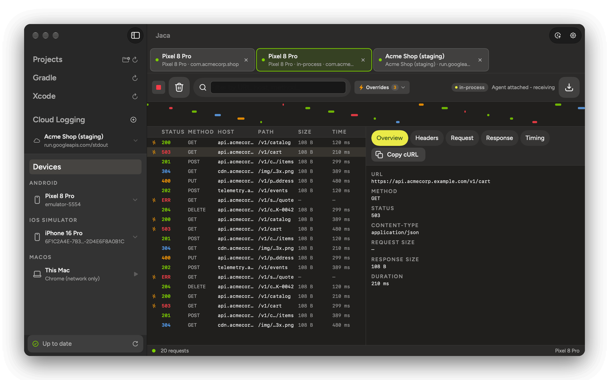
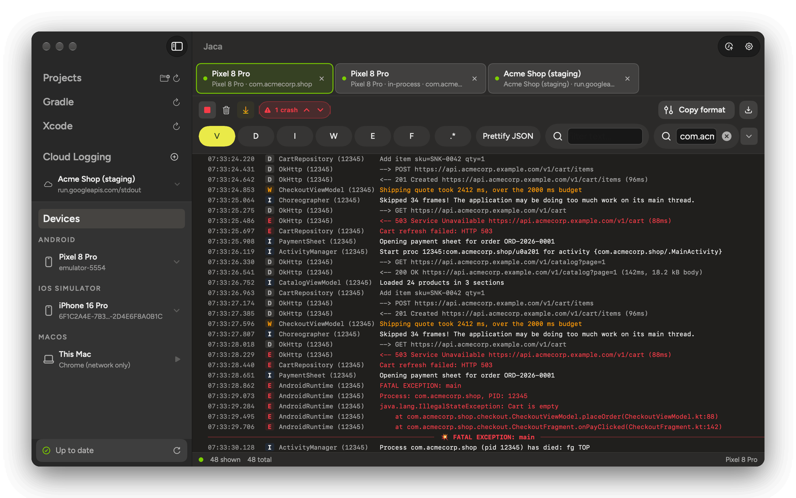
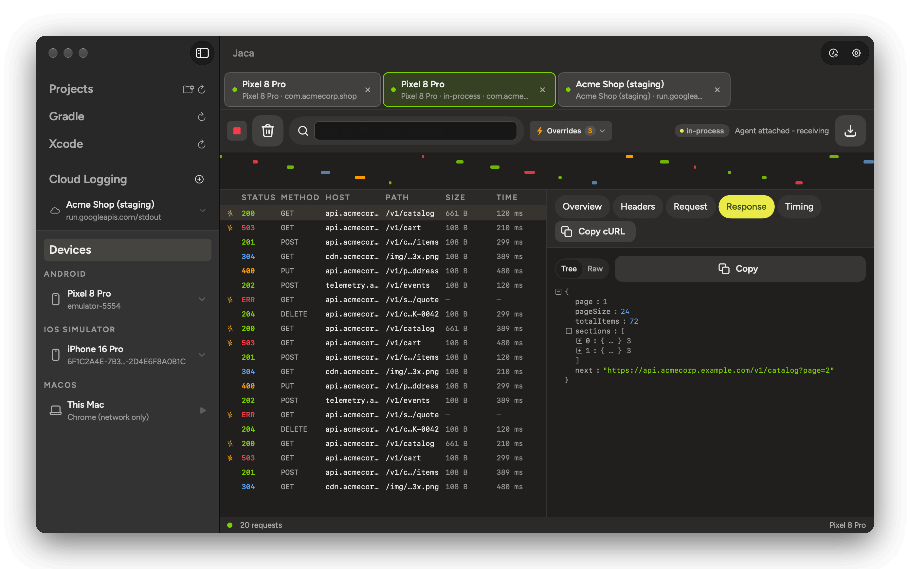
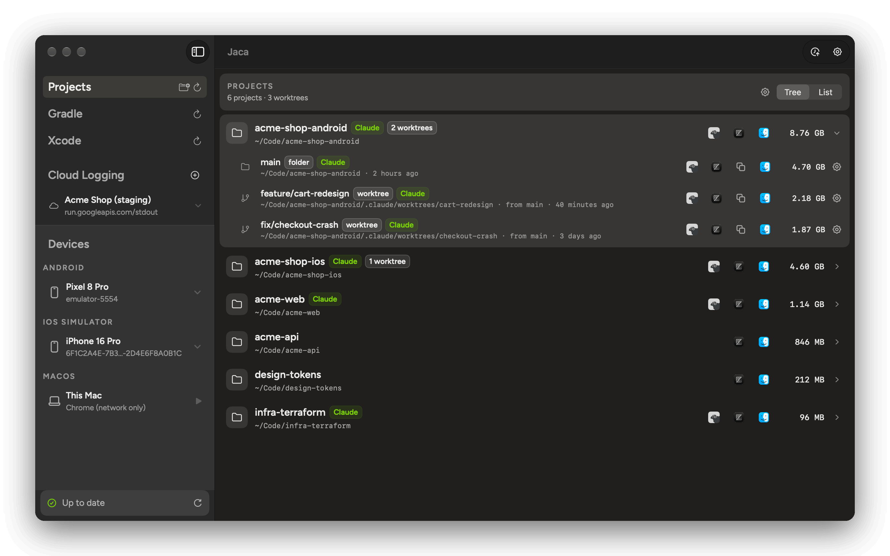

<p align="center">
  
</p>

<h1 align="center">Jaca</h1>

<p align="center">
  <b>Logs, network traffic and mocked responses for mobile and web apps.</b>
</p>

<p align="center">
  Android, iOS Simulator, iPhone and Chrome, in one macOS window.
</p>

<p align="center">
  
  
</p>

<p align="center">
  
</p>

<table>
  <tr>
    <td width="33%" valign="top">
      <b>Logs</b><br>
      Device and Cloud Logging logs, filtered by level, text, regex or app. Crashes are marked.
    </td>
    <td width="33%" valign="top">
      <b>Network</b><br>
      Every request from an app or Chrome, with headers, bodies and timing. Mock any response.
    </td>
    <td width="33%" valign="top">
      <b>Housekeeping</b><br>
      Clean Gradle, Xcode and worktree caches.
    </td>
  </tr>
</table>

## Take the tour

### Logs

Stream device logs and Google Cloud Logging, with filters and crash markers.

<p align="center">
  
</p>

### Network

See every request from Android, iOS Simulator and Chrome, and mock any response.

<p align="center">
  
</p>

### Clean your Mac

Free the space that Gradle, Xcode DerivedData and old worktrees take.

<p align="center">
  
</p>

### Terminal

Read logs, find failed requests and mock responses with `jaca`, or in Herdr panes.

```bash
jaca net requests --failed
jaca overrides add --from REQUEST --status 503
```

How to use each part: [docs/usage.md](docs/usage.md).

## Get started

You need macOS 14+, Xcode 26+ with the iOS Simulator platform, [XcodeGen](https://github.com/yonaskolb/XcodeGen), and the Android NDK and Kotlin ([details](CONTRIBUTING.md#optional-per-component)).

```bash
git clone https://github.com/teya-engineering/lemonade-design-system.git
git clone https://github.com/ujizin/Jaca.git
cd Jaca
./scripts/all.sh
```

For Android devices, put `adb` on your `PATH` or set it in Settings.

## Install

```bash
./scripts/all.sh --install
```

This replaces `/Applications/Jaca.app` and links `jaca`. There are no prebuilt releases.

> [!NOTE]
> **Update Jaca** pulls `main` into the checkout you last built from and rebuilds. It stashes and restores your changes. [Details](ARCHITECTURE.md#the-in-app-updater).

## Limitations

- Android capture needs a debuggable app.
- iOS Simulator capture sees `URLSession` only.
- iPhones have logs only.
- The Android companion app is experimental.
- iPhone logs use a private Apple framework, so an update can break them.

## Learn more

- [ARCHITECTURE.md](ARCHITECTURE.md): how the parts fit, the repository layout, data on disk, third-party licenses.
- [docs/usage.md](docs/usage.md): how to use each part, and what each device supports.
- [docs/network-capture.md](docs/network-capture.md): how each capture source works.
- [CONTRIBUTING.md](CONTRIBUTING.md): setup, tests, code rules.
- [SECURITY.md](SECURITY.md): the proxy, the CA and the agents, and how to report a vulnerability.
- [docs/README.md](docs/README.md): every doc.
