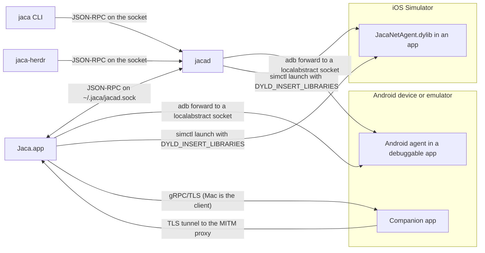

# Architecture

This page shows the parts of Jaca, how they talk, and where the code and the data live. For setup and the PR rules, read [`CONTRIBUTING.md`](../CONTRIBUTING.md). For the index of all docs, read [`docs/README.md`](README.md).

## Components

| Component | What it is | Source | Built by |
|---|---|---|---|
| Jaca (GUI app) | The SwiftUI macOS app. It runs in the menu bar and opens a window. | `Sources/App`, `Sources/Model`, `Sources/Features`, `Sources/Core` | `project.yml` target `Jaca` |
| `jacad` (daemon) | A background process. It serves the Core engines over JSON-RPC on a Unix socket. It is embedded at `Jaca.app/Contents/MacOS/jacad`. | `Sources/Core`, `Sources/Daemon/main.swift` | target `jacad` |
| `jaca` (CLI) | The same `jacad` binary, run through a symlink named `jaca`. It reads logs and captured requests, and manages response overrides. | `Sources/Core/CLI` | `scripts/install-cli.sh` makes the link |
| `jaca-herdr` (Herdr plugin) | A Go program that shows Jaca areas as Herdr panes. It is a `jacad` client. | [`herdr-plugin/`](../herdr-plugin/README.md) | `go build` |
| Android agent | An in-process agent that Jaca attaches to a debuggable Android app (JVMTI `.so` and two dex files). | [`agent/`](../agent/README.md) `native`, `java`, `kotlin`, `okhttp`, `okhttp-stubs` | `agent/build.sh`, `agent/build-dex.sh` (`scripts/build.sh` runs them) |
| iOS Simulator agent | `JacaNetAgent.dylib`, injected into a simulator app at launch. | [`agent/iOS`](../agent/README.md#ios-simulator-agent) | a post-build phase of target `Jaca` |
| Companion app | An Android app that captures whole-device traffic with a `VpnService` and streams it to the Mac. | [`mobile/`](../mobile/README.md) | `scripts/build-mobile.sh` |
| gRPC contract | The protocol between the Mac and the companion app. | [`proto/`](../proto/README.md) | `scripts/proto-gen.sh` (Swift), Gradle (Java) |

### How the processes talk



- **Socket.** The app, the CLI and the plugin all use newline-delimited JSON-RPC 2.0 on `~/.jaca/jacad.sock`. A client sends `hello` first. Any client starts `jacad` on demand.
- **Android agent.** The capture host runs `cmd activity attach-agent`, then `adb forward tcp:0 localabstract:squeeze_<random>`, with a new socket name for each attach (`Core/Network/AgentController.swift`). For response overrides, `adb reverse` brings the routed hosts back to a loopback server on the Mac (`Core/AgentHTTP`).
- **iOS Simulator agent.** The capture host relaunches the app with `SIMCTL_CHILD_DYLD_INSERT_LIBRARIES` and `SIMCTL_CHILD_JACA_NET_PORT` (`Core/Network/SimulatorAgentLaunch.swift`). The agent connects back to `127.0.0.1` on that port, because the simulator shares the Mac's loopback.
- **Companion.** The phone is the gRPC server and the Mac is the client (`Core/Companion/CompanionLink.swift`). The phone sends intercepted TLS to the Mac's MITM proxy, so the CA private key stays on the Mac. See [`companion-architecture.md`](companion-architecture.md).
- **Capture host.** The Android and iOS Simulator agents are driven by the app, or by `jacad` when the `network` daemon area is on. Companion capture always stays in the app.

## Source tree

<details>
<summary><code>Sources/</code>, one line per folder</summary>

```text
Sources/
├── App/                  GUI entry: JacaApp (menu-bar item, window, menu commands), RootView (sidebar + detail switch), DockVisibility, Assets.xcassets
├── Model/                @Observable @MainActor state: AppModel, LogSession, NetworkSession, area models, CompanionRegistry, UpdateModel
│   └── Daemon/           DaemonConnector and the remote log, network and cloud feeds that mirror jacad
├── Features/             SwiftUI views, one folder per feature
│   ├── ClaudeAssistant/  "Ask Claude" sheet and button
│   ├── CloudLogging/     Cloud Logging home, session tab, table, detail panel, query bar, SQL editor
│   ├── Database/         Database tab: app picker, database and table menus, SQL box, row detail
│   ├── Gradle/           Gradle area view and sidebar header
│   ├── History/          Saved-log history browser
│   ├── LogView/          The log tab: toolbar, AppKit table, rows, level styles, the copy-format sheet
│   ├── Network/          Network tab, detail, timeline, JSON tree, setup and CA sheets; Overrides/ holds the override editor
│   ├── Projects/         Projects area, rows, checkout actions, Herdr launch sheets
│   ├── Settings/         Settings sheet
│   ├── Shared/           UI helpers used by several features (GroveIcon glyphs, FlowLayout, content column)
│   ├── Sidebar/          Device sidebar and the companion "Connect a device" sheet
│   ├── Tabs/             Tab strip
│   ├── Update/           Sidebar update banner
│   └── Xcode/            Xcode area view and sidebar header
├── Core/                 Shared engine, no SwiftUI. The app and jacad both compile it.
│   ├── AgentHTTP/        Loopback HTTP server, adb tunnel and route frames for response overrides
│   ├── Capture/          Capture sources and CaptureSourceRegistry: companion, agent, browser (This Mac Chrome)
│   ├── ClaudeAssistant/  Runs the `claude` CLI in print mode for "Ask Claude"
│   ├── CLI/              The `jaca` command line: arguments, usage, output tables, runner
│   ├── CloudLogging/     GCP Cloud Logging through `gcloud`: projects, poller, per-session SQLite, persistence
│   ├── Companion/        Mac side of the companion link: mDNS hub, gRPC/TLS link, APK web server, QR code; Generated/ holds the gRPC stubs
│   ├── Daemon/           jacad server, client, JSON-RPC protocol, event bus, schemas; Areas/ registers each area's methods
│   ├── Database/         Read-only SQLite browsing (Android run-as, iOS Simulator app containers)
│   ├── Devices/          Device discovery (adb, simctl, devicectl, This Mac), toolchains, installed apps, DevicesEngine
│   ├── Diagnostics/      JacaLog, the diagnostic log file
│   ├── Gradle/           Gradle daemons (ps/kill) and ~/.gradle/caches sizes
│   ├── Herdr/            Drives the `herdr` CLI to open a project in a Herdr tab
│   ├── Intercept/        Transport-neutral interception pipeline and response editing
│   ├── Logs/             Log sources (logcat, simulator, physical iOS), parsers, filters, crash detector, LogStreamEngine
│   ├── Network/          Agent controllers, MITM ProxyServer, CertificateAuthority, HAR and cURL export, NetworkCaptureEngine
│   ├── Overrides/        Response-override rules, groups, matching, store, OverridesEngine
│   ├── Persistence/      HistoryStore: SQLite + FTS5 log history
│   ├── Process/          ProcessRunner and CommandRunner for adb, xcrun and git
│   ├── Projects/         Project scan, grouping, disk cache, ProjectsEngine
│   ├── Text/             Literal text search
│   ├── Update/           In-app updater: build-info sidecar, origin/main check, pull and rebuild
│   ├── Worktrees/        GitService, worktree parser, CacheCleaner, DirectorySizer, FolderWatcher
│   └── Xcode/            DerivedData scan and delete
└── Daemon/               main.swift: the entry point of jacad, and of `jaca` when run through the symlink
```

`Sources/Jaca-Bridging-Header.h` imports `Core/Logs/JacaOSLog.h`, the Objective-C bridge to Apple's private LoggingSupport framework.

</details>

Other top-level folders: `Config/` (the Info.plist that allows plain `http://` for the proxy), `Resources/` (build outputs that the scripts copy in), `Tests/` (`JacaTests`; `Tests/ObjC` is `JacaAgentTests`), `UITests/` (`JacaUITests`), `scripts/` ([`scripts/README.md`](../scripts/README.md)).

## Layering rules

| Layer | Contains | May use |
|---|---|---|
| `Sources/Core` | Processes, sockets, parsing, persistence, engines. No SwiftUI. | Core only |
| `Sources/Model` | `@Observable @MainActor` state and orchestration | Core |
| `Sources/Features` | Thin SwiftUI views | Model, Core |

- Core must never reference Model or Features. The `jacad` target compiles Core without them, so a wrong import fails the build.
- State that more than one screen reads lives in one observable owner. Views read it and do not poll it. The reference is `Model/CompanionRegistry.swift`.
- Put pure logic in free functions or enums and unit-test it.
- Do not edit `Sources/Core/Companion/Generated/` by hand. Run `scripts/proto-gen.sh`.

The full rules (area pattern, cache-first areas, migration-safe `Codable`, design system, animation) are in [`CLAUDE.md`](../CLAUDE.md) and [`CONTRIBUTING.md`](../CONTRIBUTING.md).

## Daemon areas

Each area runs in the app (the default) or in `jacad`. The switch is per area:

```bash
defaults write dev.srsouza.Jaca daemonAreas -array gradle xcode projects devices logs cloudLogging network
```

- `JACA_DAEMON_AREAS=gradle,xcode` in the environment wins over the default. `all` turns on every area.
- The area names are the cases of `DaemonArea` in `Model/Daemon/DaemonConnector.swift`: `gradle`, `xcode`, `projects`, `devices`, `logs`, `cloudLogging`, `network`.
- If the daemon cannot be reached, the area runs in the app.
- `network` runs in `jacad` only in the "Agent HTTPS debugging" mode. In "HTTPS debugging" mode, capture stays in the app.
- The database browser has no area flag. The app's Database tab is always in-process; `jacad`'s `database.*` methods serve the Herdr pane.
- The `jaca` CLI sees log and network sessions only when they run in `jacad`.

Status, protocol and design decisions: [`daemon-plan.md`](daemon-plan.md).

## Data on disk

| Location | Contents |
|---|---|
| `~/.jaca/` | `jacad.sock`, `jacad.lock`, `jacad.log` (`JACA_DAEMON_DIR` moves these three); `logs/jaca.log` (diagnostics); `network-overrides/` with `rules.json`, `groups.json` and `bodies/` (`JACA_OVERRIDES_DIR` moves it); `network/tunnels.json` (adb tunnel ledger); `cloud-logging/projects.json` and `templates.json`; `log-copy-format.json` |
| `~/Library/Caches/Jaca/` | `projects.json`, `companion-devices.json`, `ios-apps-<udid>.json`; `net-bodies/` (app) and `net-bodies-jacad/` (daemon), which each process empties at start |
| `~/Library/Application Support/Jaca/` | `history.sqlite` (log history); `ca/rootCA.pem` and `ca/rootCA.key.pem` (the MITM CA; the key file is 0600); `cloud-logging/sessions/<uuid>.sqlite`; `chrome-profile/` (This Mac Chrome); `build-info.json` (written at build time, read by the in-app updater) |
| Temp folder | `jaca-db-<UUID>/`, database snapshots |
| UserDefaults `dev.srsouza.Jaca` | Settings, `openTabs`, `daemonAreas`. `jacad` reads the same domain. |

Older builds kept the CA private key in the Keychain. The app reads the Keychain once to move the key into the file.
